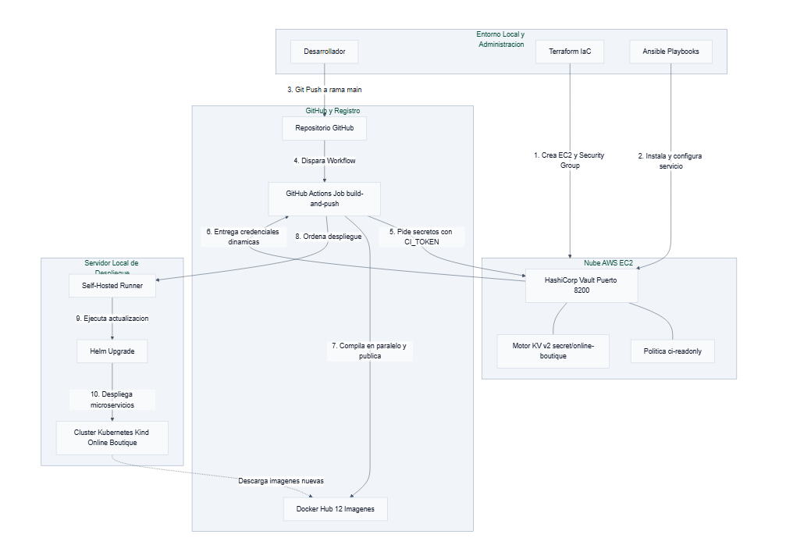

# Online Boutique DevOps
Plataforma de comercio electrónico basada en microservicios con automatización completa de infraestructura, gestión de secretos y despliegue continuo.

## El problema
El principal problema que identificamos en el proyecto es que, aunque la aplicación Online Boutique ya cuenta con diferentes microservicios y funcionalidades que permiten realizar correctamente el proceso de compra dentro de una tienda en línea, inicialmente no se contaba con una implementación de DevOps que permitiera administrar de una manera más eficiente todo el ciclo de desarrollo y operación de la aplicación.

A nivel técnico, la aplicación cuenta con una página inicial donde se muestra el catálogo de productos disponibles, permitiendo al usuario consultar características, agregar artículos al carrito de compras, modificar cantidades y confirmar su pedido. Todas estas funciones están separadas en servicios independientes como catálogo de productos, carrito de compras, pagos, envíos, recomendaciones y procesamiento de órdenes. 

Al trabajar con diferentes microservicios, cualquier modificación o actualización requería realizar procesos de manera manual, como probar los cambios, generar las nuevas versiones, desplegar los servicios y verificar que la aplicación continuara funcionando correctamente. Esto generaba un mayor tiempo de trabajo y aumentaba la posibilidad de cometer errores durante los despliegues.

Otro problema es que al no contar con procesos automatizados ni una administración centralizada de credenciales, resultaba más complicado mantener un flujo constante y seguro entre el desarrollo de nuevas funcionalidades y su puesta en funcionamiento, en donde ya dandonos cuenta el problema no se encontraba directamente en las funcionalidades actuales de Online Boutique, sino en la forma en la que se administraban, actualizaban y desplegaban los diferentes componentes que forman parte de la aplicación.

## La propuesta
La implementación de una estrategia de DevOps permite solucionar este problema al establecer procesos que ayudan a automatizar y mejorar el ciclo de desarrollo de la aplicación. Al contar con herramientas y procesos de integración y despliegue continuo, los cambios realizados en los diferentes microservicios pasan por procesos automatizados de validación, pruebas y despliegue, reduciendo la necesidad de realizar estas actividades manualmente.

Esto es especialmente importante para Online Boutique osea nuestro proyecto ya que debido a que la aplicación está formada por varios microservicios que trabajan de manera conjunta. Con DevOps se logra tener un proceso más controlado para realizar cambios en cada uno de estos servicios, detectar errores de manera más rápida y facilitar la entrega de nuevas versiones de la aplicación.

El principal beneficio esperado para el negocio es poder realizar actualizaciones y mejoras de la aplicación de una manera más rápida, segura y organizada, sin afectar de manera innecesaria el funcionamiento de la tienda en línea. Al automatizar parte de los procesos de pruebas, manejo de secretos y despliegue, se reduce el tiempo dedicado a actividades manuales repetitivas, permitiendo que el equipo pueda enfocarse más en desarrollar nuevas funcionalidades que generen valor para los usuarios y facilitando el crecimiento del proyecto conforme aumenten las necesidades del negocio.

Para mantener un mejor control de los cambios del proyecto se utiliza una estrategia de branching donde se tiene una rama principal main para mantener la versión estable y una rama develop o desarrollo para integrar los cambios antes de llevarlos a producción. Para cada nueva funcionalidad o modificación se utilizan ramas independientes tipo feature, evitando trabajar directamente sobre main. Una vez terminados los cambios esto se realiza un pull request hacia develop para revisar y validar el código antes de integrarlo, con la finalidad de reducir errores y mantener organizado el desarrollo.

## Arquitectura

## Tecnologías usadas
* Docker para la generación de imágenes y contenedores de los doce microservicios.
* Kubernetes y Kind para la administración del clúster local donde opera la tienda.
* Helm para empaquetar y actualizar el despliegue completo de los servicios en Kubernetes.
* Terraform para la creación de infraestructura como código en la nube de AWS.
* Ansible para la automatización de la configuración e instalación de paquetes en el servidor remoto.
* HashiCorp Vault para la administración centralizada de secretos y control de acceso mediante políticas.
* GitHub Actions para la automatización de los flujos de construcción, prueba y despliegue continuo.

## Cómo funciona

### Infraestructura
Dentro de la carpeta terraform_aws se encuentra el archivo main.tf junto con el archivo de bloqueo .terraform.lock.hcl. Esta configuración permite crear de forma automatizada una instancia EC2 en AWS y su grupo de seguridad correspondiente, abriendo únicamente el puerto 22 para administración remota por SSH y el puerto 8200 para la comunicación con la interfaz y API de Vault.
El portero: puertos 22 (SSH) y 8200 (Vault)
resource "aws_security_group" "vault" {
  name        = "fase3-vault-sg"
  description = "SSH y Vault"

  ingress {
    description = "SSH"
    from_port   = 22
    to_port     = 22
    protocol    = "tcp"
    cidr_blocks = ["0.0.0.0/0"]
  }

  ingress {
    description = "Vault"
    from_port   = 8200
    to_port     = 8200
    protocol    = "tcp"
    cidr_blocks = ["0.0.0.0/0"]
  }

  egress {
    from_port   = 0
    to_port     = 0
    protocol    = "-1"
    cidr_blocks = ["0.0.0.0/0"]
  }
}
### Pipeline CI/CD
El flujo de integración y entrega continua está definido en la carpeta .github/workflows mediante los archivos vault-demo.yml y ci-build.yml. Cuando se confirma un cambio en la rama main el trabajo build-and-push se autentica contra Vault para obtener el usuario y token de Docker Hub sin tenerlos guardados en GitHub, levanta una matriz que compila y sube en paralelo los doce microservicios de la tienda. Al finalizar la subida de imágenes el trabajo deploy se ejecuta en un runner local conectado al repositorio y aplica el comando helm upgrade para actualizar el clúster de Kubernetes.
jobs:
  probar-vault:
    runs-on: ubuntu-latest
    steps:
      - name: Obtener credenciales desde Vault
        uses: hashicorp/vault-action@v3
        with:
          url: ${{ vars.VAULT_ADDR }}
          token: ${{ secrets.VAULT_TOKEN }}
          secrets: |
            secret/data/online-boutique/dockerhub username | DOCKERHUB_USERNAME ;
            secret/data/online-boutique/dockerhub token | DOCKERHUB_TOKEN

      - name: Comprobar que llegaron sin exponerlos
        run: |
          echo "Usuario de Docker Hub: $DOCKERHUB_USERNAME"
          TOKEN_LENGTH=${#DOCKERHUB_TOKEN}
          echo "El token mide $TOKEN_LENGTH caracteres"

      - name: Iniciar sesión en Docker Hub
        uses: docker/login-action@v3
        with:
          username: ${{ env.DOCKERHUB_USERNAME }}
          password: ${{ env.DOCKERHUB_TOKEN }}
### Configuración y secretos
En el directorio ansible-lab se incluye el inventario inventario-aws.ini, las variables en group_vars/vault.yml, la plantilla templates/vault.hcl.j2 y el playbook instalar-vault.yml. Con Ansible se automatiza la instalación de Vault en el servidor de AWS y se deja corriendo como servicio del sistema, en la carpeta ansible-lab/politicas se definen los archivos admin.hcl, dev-online-boutique.hcl y ci-readonly.hcl. Con la política ci-readonly se asegura el principio de mínimo privilegio para que el token del pipeline solo pueda leer los secretos necesarios de online-boutique sin poder modificar datos, listar directorios ni consultar políticas del servidor.

path "secret/data/online-boutique/*" {
  capabilities = ["read"]
}
--------
 - name: Generar configuracion de Vault desde template
      ansible.builtin.template:
        src: vault.hcl.j2
        dest: /etc/vault.d/vault.hcl
        owner: vault
        group: vault
        mode: "0640"
      notify: Reiniciar Vault

    - name: Asegurar que Vault este corriendo y arranque solo
      ansible.builtin.service:
        name: vault
        state: started
        enabled: true
## Cómo levantarlo
1. Entrar a la carpeta terraform_aws y ejecutar terraform init seguido de terraform apply para crear el servidor en AWS.
2. Colocar la dirección IP pública del servidor en el archivo ansible-lab/inventario-aws.ini y correr el playbook con ansible-playbook -i inventario-aws.ini instalar-vault.yml.
3. Conectarse al servidor para inicializar Vault con vault operator init y desellar el servicio ejecutando vault operator unseal con dos llaves Shamir.
4. Habilitar el motor de secretos KV versión 2, registrar las políticas de la carpeta ansible-lab/politicas y guardar los secretos de dockerhub y redis dentro de la ruta secret/online-boutique.
5. Crear un token con la política ci-readonly y guardarlo en los secretos de GitHub Actions con el nombre VAULT_TOKEN, además de registrar la dirección del servidor en la variable VAULT_ADDR.
6. Iniciar el clúster local con Kind, encender el runner local desde la terminal ejecutando run.cmd y hacer un push a la rama main para activar todo el flujo automatizado.

## Resultados
* Construcción y actualización automatizada de los doce microservicios de Online Boutique mediante una matriz en paralelo en GitHub Actions.
* Eliminación total de credenciales fijas de Docker Hub en el repositorio, consumiendo los secretos en tiempo real desde HashiCorp Vault en AWS.
* Comprobación práctica del principio de mínimo privilegio tanto en consola como en la interfaz web de Vault, logrando lecturas exitosas en rutas autorizadas y bloqueos con código 403 ante intentos de escritura o listado.
* Repositorio limpio y seguro excluyendo archivos sensibles como llaves privadas, estados de Terraform y archivos de tokens mediante reglas en .gitignore.

# Archivos sensibles que NUNCA deben ir al repositorio
vault-llaves.txt
*.tfstate
*.tfstate.*
.terraform/
fase3-vault
fase3-vault.pem
fase3-vault.id_rsa
*.pem
credentials
Fragmento del .gitignore
## Retos y lecciones aprendidas
* Sellar Vault y recuperación del servicio: Comprobamos que al reiniciar el servicio de Vault el servidor pasa a estado sellado por seguridad y provoca que el pipeline falle en el paso de obtención de credenciales con error 503, lo cual se resuelve aplicando las llaves Shamir con vault operator unseal.
* Revocación de tokens comprometidos por el que accesa: Aprendimos a auditar tokens activos y revocar el acceso del pipeline utilizando su identificador accessor sin necesidad de conocer el token real, provocando un bloqueo inmediato con error 403 hasta generar y configurar una credencial nueva.
* Comportamiento con el runner local apagado: Verificamos que al enviar un cambio con el runner apagado, los doce trabajos de construcción en la nube de GitHub se completan sin problema mientras el trabajo de despliegue se mantiene en espera hasta que el runner local vuelve a encenderse.
* El problema del secreto cero: Analizamos por qué VAULT_TOKEN no puede guardarse dentro de Vault, entendiendo que se requiere una credencial inicial alojada en la plataforma de ejecución para poder autenticarse y abrir la bóveda por primera vez.
* Administración de direcciones IP dinámicas: Al apagar y encender la instancia de AWS en días distintos, la dirección IP pública cambiaba, lo que nos enseñó a actualizar la variable VAULT_ADDR en GitHub, ajustar el entorno local y desellar nuevamente Vault antes de ejecutar las pruebas.

## Autor
Alexander Enrique De La Barrera Martinez
